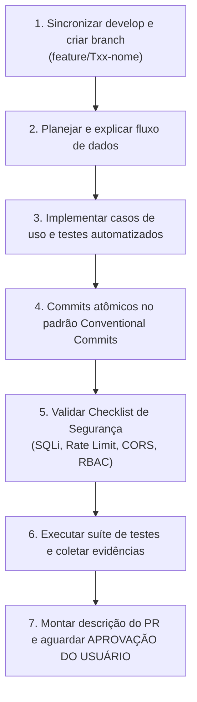

# Fluxo Operacional e Registro de Ações dos Agentes

**Projeto:** Sistema de Almoxarifado de Obras (JOOY Construtora + SENAI)  
**Objetivo:** Padronizar o ciclo de desenvolvimento autônomo e rastrear todas as ações executadas pelos agentes de IA.

---

## 1. Regras Fundamentais de Operação do Agente

Todo agente que atuar no repositório deve seguir rigidamente o seguinte protocolo:



---

## 2. Passo a Passo do Ciclo de uma Feature

### Passo 1: Criação da Branch da Feature
- Nenhuma alteração é feita diretamente na `main` ou na `develop`.
- O agente deve criar uma nova branch a partir da `develop`:
  ```bash
  git checkout develop
  git pull origin develop  # se houver remote
  git checkout -b feature/Txx-descricao-curta
  ```

### Passo 2: Desenvolvimento Guiado por Testes (Testes Automatizados)
- O agente deve escrever testes de unidade e/ou integração utilizando **Vitest**.
- **Ritual Vermelho -> Verde:** O teste deve falhar antes da implementação (provando o cenário) e passar com a regra implementada.
- Cobrir cenários felizes e de erro (ex.: 400 Bad Request, 401 Unauthorized, 403 Forbidden, 404 Not Found, 409 Conflict, 422 Unprocessable Entity).

### Passo 3: Commits Atômicos e Convencionais
- Mensagens de commit no padrão Conventional Commits:
  - `feat(modulo): nova funcionalidade`
  - `fix(modulo): correcao de bug comprovada`
  - `test(modulo): novos testes automatizados`
  - `refactor(modulo): melhoria interna sem alterar comportamento`
  - `chore(infra): ajustes de dependencias, scripts ou configuracao`
- **Regras de commit:**
  - Em letras minúsculas, sem acentos, sem ponto final.
  - Nunca commitar arquivos `.env`, `node_modules/`, `.idea/`, logs ou caches.

### Passo 4: Validação de Segurança Básica
- O agente deve conferir o arquivo [`documentos/VERIFICACAO_SEGURANCA.md`](file:///c:/Users/Guilherme/Documents/Faculdade/Projetos/obras-jooy/documentos/VERIFICACAO_SEGURANCA.md) e certificar-se de que a funcionalidade respeita:
  - Parametrização estrita de banco (Prisma ORM sem `$queryRawUnsafe`);
  - Proteção de Rate Limit se for endpoint sensível;
  - Validação de entrada completa com Zod;
  - Restrição de RBAC ativa (pre-handler de perfil);
  - Nenhum dado sigiloso (como `senhaHash`) exposto na saída.

### Passo 5: Coleta de Evidências Reais
- O agente deve rodar os comandos de teste e build:
  ```bash
  cd backend; npm run test
  cd backend; npm run build
  ```
- Colar no relatório a saída dos testes com o número de asserções executadas e o tempo.

### Passo 6: Submissão do Pull Request para Aprovação
- O agente prepara o texto completo do Pull Request contendo:
  - **Título:** `feat(Txx): descrição clara da entrega`
  - **Branch de Origem:** `feature/Txx-descricao` $\rightarrow$ **Branch de Destino:** `develop`
  - **O que foi feito:** tópicos concisos das alterações.
  - **Como testar:** instruções reproduzíveis passo a passo.
  - **Evidências:** checklist com `[x]` estritamente nas provas obtidas.
  - **Riscos e Observações:** impactos colaterais ou pendências.
- 🛑 **Parada Obrigatória:** O agente **NÃO realiza o merge** por conta própria. O PR é submetido e o agente aguarda a validação e autorização explícita do usuário.

---

## 3. Matriz de Registro e Log das Ações do Agente

Esta seção deve ser mantida atualizada pelo agente a cada tarefa realizada:

| ID Tarefa | Branch Criada | Escopo / Descrição | Testes Automatizados | Status | Aprovado pelo Usuário? |
|---|---|---|---|---|---|
| **SETUP-01** | `main` / `develop` | Inicialização do Git, .gitignore, README e plano base | N/A (Setup) | Concluído | Sim |
| **SETUP-02** | `main` / `develop` | Criação da pasta `documentos/` e transposição da stack para Node.js + Prisma | N/A (Documentação) | Concluído | Sim |
| **SEC-01** | `main` / `develop` | Criação dos guias de segurança e fluxo operacional dos agentes | N/A (Documentação) | Concluído | Aguardando validação |
| **T01** | `feature/T01-docker-compose` | Docker Compose seguro (PostgreSQL 16 porta 5433), .env.example e .gitignore | Teste de interpolação e falha | Concluído | Sim (PR #1 mergeado) |
| **T02** | `feature/T02-backend-setup` | Setup backend Node.js, Fastify, Prisma, Zod, Health e Swagger | 12 testes Vitest | Pronto para PR | Aguardando aprovação |
| **T03** | *(a criar)* | Setup frontend React + Vite + TS e proxy de API | Vitest / Lint | Pendente | Não |
| **T04** | *(a criar)* | Autenticação JWT, Usuários e RBAC | Vitest | Pendente | Não |
| **T05** | *(a criar)* | Gestão de Obra e Áreas da Obra | Vitest | Pendente | Não |
| **T06** | *(a criar)* | Empresas e Pessoas | Vitest | Pendente | Não |
| **T07** | *(a criar)* | Catálogo de Materiais e Unidades com Conversão | Vitest | Pendente | Não |
| **T08** | *(a criar)* | Estoque Base, Saldos e Livro-Razão Imutável | Vitest (Concorrência) | Pendente | Não |
| **T09** | *(a criar)* | Recebimento com conversão e controle sem documento | Vitest | Pendente | Não |
| **T10** | *(a criar)* | Parâmetros de Estoque Mínimo e Máximo | Vitest | Pendente | Não |
| **T11** | *(a criar)* | Requisição com Idempotência e validações | Vitest | Pendente | Não |
| **T12** | *(a criar)* | Separação, Reserva Atômica e Baixa com Código | Vitest (Atômico) | Pendente | Não |
| **T13** | *(a criar)* | Limites de Material por Obra e Área | Vitest | Pendente | Não |
| **T14** | *(a criar)* | Ativos e Ferramentas (próprias, locadas, terceiros) | Vitest | Pendente | Não |
| **T15** | *(a criar)* | Empréstimo e Teste de Saída da Ferramenta | Vitest | Pendente | Não |
| **T16** | *(a criar)* | Devolução, Teste Pós-Retorno e Ocorrências | Vitest | Pendente | Não |
| **T17** | *(a criar)* | Relatórios Operacionais e Kardex | Vitest | Pendente | Não |
| **T18** | *(a criar)* | Auditoria e Rate Limiting avançado | Vitest | Pendente | Não |
| **T19** | *(a criar)* | Testes de Integração Ponta a Ponta | E2E | Pendente | Não |
| **T20** | *(a criar)* | Documentação Final e Entrega | N/A | Pendente | Não |
