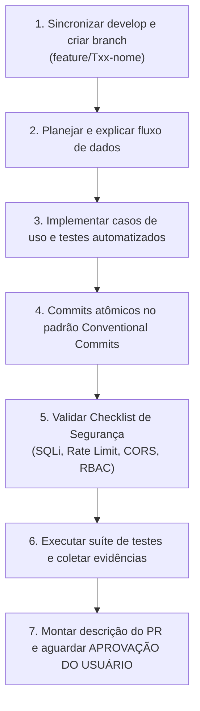

# Fluxo Operacional e Registro de Ações dos Agentes

**Projeto:** Sistema de Almoxarifado de Obras (JOOY Construtora + SENAI)  
**Objetivo:** Padronizar o ciclo de desenvolvimento autônomo e rastrear todas as ações executadas pelos agentes de IA.

---

## 1. Regras Fundamentais de Operação do Agente

Todo agente que atuar no repositório deve seguir rigidamente o seguinte protocolo:



---

## 2. Passo a Passo do Ciclo de uma Feature

### Passo 1: Criação da Branch da Feature
- Nenhuma alteração é feita diretamente na `main` ou na `develop`.
- O agente deve criar uma nova branch a partir da `develop`:
  ```bash
  git checkout develop
  git pull origin develop  # se houver remote
  git checkout -b feature/Txx-descricao-curta
  ```

### Passo 2: Desenvolvimento Guiado por Testes (Testes Automatizados)
- O agente deve escrever testes de unidade e/ou integração utilizando **Vitest**.
- **Ritual Vermelho -> Verde:** O teste deve falhar antes da implementação (provando o cenário) e passar com a regra implementada.
- Cobrir cenários felizes e de erro (ex.: 400 Bad Request, 401 Unauthorized, 403 Forbidden, 404 Not Found, 409 Conflict, 422 Unprocessable Entity).

### Passo 3: Commits Atômicos e Convencionais
- Mensagens de commit no padrão Conventional Commits:
  - `feat(modulo): nova funcionalidade`
  - `fix(modulo): correcao de bug comprovada`
  - `test(modulo): novos testes automatizados`
  - `refactor(modulo): melhoria interna sem alterar comportamento`
  - `chore(infra): ajustes de dependencias, scripts ou configuracao`
- **Regras de commit:**
  - Em letras minúsculas, sem acentos, sem ponto final.
  - Nunca commitar arquivos `.env`, `node_modules/`, `.idea/`, logs ou caches.

### Passo 4: Validação de Segurança Básica
- O agente deve conferir o arquivo [`documentos/VERIFICACAO_SEGURANCA.md`](file:///c:/Users/Guilherme/Documents/Faculdade/Projetos/obras-jooy/documentos/VERIFICACAO_SEGURANCA.md) e certificar-se de que a funcionalidade respeita:
  - Parametrização estrita de banco (Prisma ORM sem `$queryRawUnsafe`);
  - Proteção de Rate Limit se for endpoint sensível;
  - Validação de entrada completa com Zod;
  - Restrição de RBAC ativa (pre-handler de perfil);
  - Nenhum dado sigiloso (como `senhaHash`) exposto na saída.

### Passo 5: Coleta de Evidências Reais
- O agente deve rodar os comandos de teste e build:
  ```bash
  cd backend; npm run test
  cd backend; npm run build
  ```
- Colar no relatório a saída dos testes com o número de asserções executadas e o tempo.

### Passo 6: Submissão do Pull Request para Aprovação
- O agente prepara o texto completo do Pull Request contendo:
  - **Título:** `feat(Txx): descrição clara da entrega`
  - **Branch de Origem:** `feature/Txx-descricao` $\rightarrow$ **Branch de Destino:** `develop`
  - **O que foi feito:** tópicos concisos das alterações.
  - **Como testar:** instruções reproduzíveis passo a passo.
  - **Evidências:** checklist com `[x]` estritamente nas provas obtidas.
  - **Riscos e Observações:** impactos colaterais ou pendências.
- **Parada Obrigatória:** O agente **NÃO realiza o merge** por conta própria. O PR é submetido e o agente aguarda a validação e autorização explícita do usuário.

---

## 3. Matriz de Registro e Log das Ações do Agente

Esta seção deve ser mantida atualizada pelo agente a cada tarefa realizada:

| ID Tarefa | Branch Criada | Escopo / Descrição | Testes Automatizados | Status | Aprovado pelo Usuário? |
|---|---|---|---|---|---|
| **SETUP-01** | `main` / `develop` | Inicialização do Git, .gitignore, README e plano base | N/A (Setup) | Concluído | Sim |
| **SETUP-02** | `main` / `develop` | Criação da pasta `documentos/` e transposição da stack para Node.js + Prisma | N/A (Documentação) | Concluído | Sim |
| **SEC-01** | `main` / `develop` | Criação dos guias de segurança e fluxo operacional dos agentes | N/A (Documentação) | Concluído | Aguardando validação |
| **T01** | `feature/T01-docker-compose` | Docker Compose seguro (PostgreSQL 16 porta 5433), .env.example e .gitignore | Teste de interpolação e falha | Concluído | Sim (PR #1 mergeado) |
| **T02** | `feature/T02-backend-setup` | Setup backend Node.js, Fastify, Prisma, Zod, Health e Swagger | 12 testes Vitest | Concluido | Sim (PR #2 mergeado) |
| **T03** | `feature/T03-frontend-setup` | Setup frontend React + Vite + TS, TanStack Query, Axios e proxy /api | 2 testes Vitest | Concluido | Sim (PR #3 mergeado) |
| **T04** | `feature/T04-autenticacao-usuarios` | Autenticacao JWT, Tabela de Cargos, Gestao de Usuarios e RBAC | 42 testes Vitest (26 backend + 16 frontend) | Concluido | Sim (PR #4 mergeado) |
| **T05** | `feature/T05-obras-areas` | Cadastro de Obra, Cidade e Gestao de Areas (RBAC Engenharia e Admin) | 29 testes Vitest (22 backend + 7 frontend) | Concluido | Sim (PR #5 mergeado) |
| **T06** | *(descartada)* | Empresas e Pessoas | N/A | Descartada | Sim (Responsavel textual na baixa/emprestimo) |
| **T07** | `feature/T07-catalogo-materiais` | Catalogo de Materiais, Unidades e Categorias com Fator de Conversao | 24 testes Vitest (16 backend + 8 frontend) | Concluido | Sim (PR #6 mergeado) |
| **AJUSTE-USER** | `feature/ajustes-gestao-usuarios` | Edicao e exclusao segura de usuarios com bloqueio por historico | 7 testes Vitest (3 backend + 4 frontend) | Concluido | Sim (PR #7 mergeado) |
| **T11** | `feature/T11-requisicoes-obra` | Modulo de Requisicoes de Obra e Isolamento de Acesso para Encarregado | 12 testes Vitest (9 backend + 3 frontend) | Concluido | Sim (PR #8 mergeado) |
| **T08** | `feature/T08-estoque-livro-razao` | Estoque Fisico, Saldos, Locacoes Opcionais e Livro-Razao Imutavel (Kardex) | 19 testes Vitest (15 backend + 4 frontend) | Concluido | Sim (PR #9 mergeado) |
| **T12** | `feature/T12-atendimento-requisicoes-sienge` | Validacao de Saldo na Requisicao, Atendimento com Baixa Atomica no Estoque e Exportacao CSV para SIENGE | 19 testes Vitest (14 backend + 5 frontend) | Concluido | Sim (PR #10 mergeado) |
| **T13** | `feature/T13-orcamento-obra` | Orcamento e Limites de Material por Obra, Exibicao de Limite na Requisicao e Painel Grafico para Engenharia/Administracao | 9 testes Vitest (7 backend + 2 frontend) | Concluido | Sim (PR #11 mergeado - preservado em branch de portfolio) |
| **F01** | `feature/F01-vinculo-usuario-obra` | Vinculo de usuario a obra (lotacao fixa para Encarregado e Almoxarife sem selecao manual) | 11 testes Vitest | Concluido | Sim (PR #12 mergeado) |
| **F03** | `feature/F03-codigo-sienge-opcional` | Codigo proprio do material obrigatorio e codigo SIENGE opcional e editavel | 9 testes Vitest | Concluido | Sim (PR #13 mergeado) |
| **F02** | `feature/F02-etapas-por-local` | Etapas de execucao por pavimento/area com bloqueio de requisicoes quando encerradas | 13 testes Vitest | Concluido | Sim (PR #14 mergeado) |
| **F04** | `feature/F04-exportacao-analitica-engenharia` | Relatorio analitico e exportacao CSV com filtros por data, material, codigo e etapa | 12 testes Vitest | Concluido | Sim (PR #15 mergeado) |
| **F05** | `feature/F05-pwa-requisicoes-offline` | Modo Offline PWA para requisicoes sem conexao e sincronizacao automatica | 15 testes Vitest | Concluido | Sim (PR #16 mergeado) |
| **F06** | `feature/F06-cautela-ferramentas` | Cautela e devolucao de ferramentas exclusiva do almoxarife com teste obrigatorio | 14 testes Vitest | Concluido | Sim (PR #17 mergeado) |
| **UI-EST** | `feature/busca-pesquisavel-inserir-estoque` | Seletor com filtro de busca pesquisavel para inserir itens ao estoque | 4 testes Vitest | Concluido | Sim (PR #18 mergeado) |
| **PWA-AUTH** | `feature/login-offline-pwa` | Autenticacao e login offline com hash de credencial seguro no dispositivo | 9 testes Vitest | Concluido | Sim (PR #19 mergeado) |
| **UI-ENC** | `feature/ajustes-perfil-encarregado-home` | Ajuste de tela inicial e navegacao para perfil encarregado e remocao de debug | 10 testes Vitest | Concluido | Sim (PR #20 mergeado) |
| **REL-1.0** | `develop` -> `main` | Release v1.0.0, Manual do Usuario, README, Render Blueprint e Feature Flags | 212 testes (129 BE + 83 FE) | Concluido | Sim (PRs #21 a #25 mergeados) |
| **F07** | `feature/F07-background-sync-nativo` | Sincronizacao em segundo plano nativa no Service Worker (Background Sync API + Periodic Sync + fila IndexedDB + timer de 5 min para catalogo) | Vitest (backgroundSync, useOfflineSync, offlineStorage) | Em execucao | Aguardando aprovacao do PR |
| **F08** | `feature/F08-banner-instalacao-pwa` | Banner inteligente de instalacao mobile detectando dispositivo via User-Agent (Android/iOS) e modo standalone | Vitest | Pendente (Proxima Task) | Nao |
