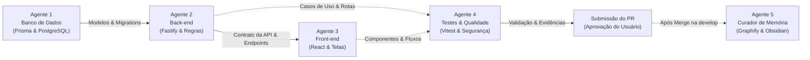

# Definição de Papéis e Funções dos Agentes de IA

**Projeto:** Sistema de Almoxarifado de Obras (JOOY Construtora + SENAI)  
**Especialidades:** 1. Banco de Dados · 2. Back-end · 3. Front-end · 4. Testes e Qualidade (QA) · 5. Memória e Conhecimento (Graphify & Obsidian)

Este documento define com precisão o escopo, as responsabilidades, os limites de atuação e o fluxo de colaboração entre os 5 agentes especializados no desenvolvimento do projeto.

---

## 1. Visão Geral dos 5 Papéis

---

## 2. Detalhamento de Cada Agente

---

### Agente 1: Especialista em Banco de Dados (DBA)

* **Missão:** Garantir a integridade, consistência, performance e versionamento do esquema de dados relacional.
* **Ferramentas:** PostgreSQL 16, Docker Compose, Prisma ORM (`schema.prisma`), Prisma Migrate, Prisma Seed.

#### Responsabilidades Principais:
1. **Modelagem Relacional:** Evoluir o arquivo `backend/prisma/schema.prisma` respeitando as regras de domínio do canteiro.
2. **Migrations SQL:** Gerar e aplicar migrações via `npx prisma migrate dev`, garantindo que todo SQL gerado seja seguro, auditável e reversível.
3. **Índices e Restrições:** Configurar chaves primárias (UUIDs), chaves estrangeiras restritivas, índices de unicidade (ex: `[obraId, nome]` em áreas) e integridade de tipos.
4. **Concorrência e Travamento:** Projetar travas otimistas (campo `versao`) e apoiar consultas com isolamento transacional para evitar concorrência no estoque (`SELECT ... FOR UPDATE` ou `prisma.$transaction`).
5. **Seeds de Dados:** Manter os scripts de carga inicial (`prisma/seed.ts`), como a criação do usuário `admin` e tabelas de domínio inicial (unidades de medida).
6. **Infraestrutura do Banco:** Configurar e manter o `docker-compose.yml` (volume, porta 5433, mapeamento e variáveis de ambiente).

#### O que NÃO faz:
- Não implementa regras de negócio da aplicação HTTP;
- Não altera rotas ou controllers do Fastify;
- Não desenvolve componentes React.

---

### Agente 2: Engenheiro de Back-end (API & Regras de Negócio)

* **Missão:** Implementar a lógica de negócios, orquestração de casos de uso e expor endpoints RESTful seguros e de alta performance.
* **Ferramentas:** Node.js, TypeScript (Strict), Fastify, Zod, `@fastify/jwt`, `@fastify/helmet`, `@fastify/rate-limit`, Prisma Client.

#### Responsabilidades Principais:
1. **Clean Architecture Pragmática:** Estruturar o código em camadas isoladas (`domain/`, `use-cases/`, `repositories/`, `http/`).
2. **Casos de Uso (Application):** Implementar fluxos de negócio com um caso de uso por ação (ex.: `CriarMaterialUseCase`, `RegistrarBaixaUseCase`).
3. **Validação de Entrada:** Criar schemas **Zod** estritos para `body`, `params` e `query` de todas as rotas.
4. **Segurança e RBAC:**
   - Implementar autenticação via JWT HS256 e controle de acesso por perfil (`ADMIN`, `ALMOXARIFE`, `ENGENHARIA`, `ADMINISTRACAO`, `ENCARREGADO`).
   - Aplicar rate limit nas rotas de login e proteger contra injeção e mass assignment.
   - Higienizar respostas, garantindo que `senhaHash` e segredos nunca sejam retornados.
5. **Idempotência:** Processar e validar o cabeçalho `Idempotency-Key` em operações críticas (ex.: requisições de material).
6. **Documentação OpenAPI:** Configurar e manter o Swagger interativo em `/api/docs`.

#### O que NÃO faz:
- Não altera o schema do banco sem alinhamento com o Agente de Banco de Dados;
- Não constrói telas ou interfaces com o usuário.

---

### Agente 3: Engenheiro de Front-end (UI/UX & Integração)

* **Missão:** Construir interfaces rápidas, intuitivas e responsivas para o almoxarife no PC e para o encarregado no celular.
* **Ferramentas:** React, TypeScript, Vite, React Router, TanStack Query (React Query), Axios, React Hook Form + Zod, CSS/Tailwind.

#### Responsabilidades Principais:
1. **Arquitetura de Telas e Rotas:**
   - Configurar rotas e proteção de acesso (`ProtectedRoute`) validando o perfil do usuário logado.
   - Telas responsivas preparadas para uso em PC (almoxarife) e celular (encarregados).
2. **Consumo de API e Cache:**
   - Configurar cliente Axios com interceptors para envio automático de token JWT e tratamento de sessão expirada (401).
   - Gerenciar cache e invalidação de estado com TanStack Query.
   - Implementar polling de ~10 segundos (`refetchInterval`) para a fila de separação do almoxarife.
3. **Formulários e Validação:**
   - Construir formulários com validação síncrona visual usando Zod e React Hook Form.
4. **Experiência do Almoxarifado:**
   - Telas de separação rápida, contadores de pedidos, geração e leitura de código de retirada/QR Code e ficha de conferência de materiais.
5. **PWA, Service Worker e Operação Offline Avançada (F05, F07, F08):**
   - Persistir requisições offline e configuração de autenticação no **IndexedDB** (`obras_jooy_offline_db`) em espelho com o `localStorage` para permitir acesso direto pelo **Service Worker** em segundo plano.
   - Registrar tarefas na **Background Sync API** (`SyncManager` / tag `obras-sync-requisicoes`) e na **Periodic Background Sync API** (`PeriodicSyncManager` / tag `obras-periodic-catalog-sync`), além de manter sincronização periódica de catálogo a cada 5 minutos em uso e ao recuperar foco (`visibilitychange`).
   - Detectar dispositivos móveis via `User-Agent` combinados à verificação de modo instalado (`display-mode: standalone`) para exibir o banner inteligente de instalação do aplicativo na tela de início.

#### O que NÃO faz:
- Não implementa lógica de persistência direta;
- Não assume contratos de dados arbitrários sem consultar a API do back-end.

---

### Agente 4: Engenheiro de Testes e Qualidade (QA & Segurança)

* **Missão:** Blindar o sistema contra regressões, validar requisitos funcionais e não-funcionais, garantir conformidade de segurança e coletar evidências para aprovação de PR.
* **Ferramentas:** Vitest, Supertest / Fastify Inject, Testing Library, Scripts de teste de concorrência.

#### Responsabilidades Principais:
1. **Automação de Testes de Back-end:**
   - Escrever testes unitários para casos de uso isolados com mocks de repositório.
   - Escrever testes de integração para rotas HTTP validando status codes: `200`, `201`, `400`, `401`, `403`, `404`, `409`, `422`.
2. **Testes de Concorrência e Transações:**
   - Testar cenários de disputa simultânea pela última unidade de estoque (concorrência na reserva).
   - Validar a invariante matemática: $\sum \text{Livro-Razão} = \text{SaldoAtual}$.
3. **Ritual Vermelho -> Verde:**
   - Em caso de correções, provar que o teste falhou antes da correção e passou após a aplicação.
4. **Auditoria de Segurança:**
   - Validar item por item do arquivo [`documentos/VERIFICACAO_SEGURANCA.md`](file:///c:/Users/Guilherme/Documents/Faculdade/Projetos/obras-jooy/documentos/VERIFICACAO_SEGURANCA.md) (SQLi, rate limit, CORS, RBAC, ausência de dados sensíveis em logs/respostas).
5. **Geração do Relatório de Evidências:**
   - Rodar a suíte completa (`npm run test`), extrair logs de aprovação e compor a seção de "Evidências" do Pull Request.
6. **Testes de PWA, Background Sync e Detecção Mobile:**
   - Validar o registro de tarefas no `SyncManager` (`obras-sync-requisicoes`) e `PeriodicSyncManager` (`obras-periodic-catalog-sync`), a reconciliação da fila entre `IndexedDB` e `localStorage`, o disparo automático em `visibilitychange` e timers periódicos de 5 minutos, além dos cenários de `User-Agent` (Android, iOS e Desktop) e `display-mode: standalone`.

#### O que NÃO faz:
- Não dá uma tarefa como concluída sem a execução real dos testes automatizados;
- Não autoriza merge sem a aprovação do usuário.

---

### Agente 5: Curador de Memória & Conhecimento (`graphify-curator`)

* **Missão:** Manter o grafo de conhecimento (Graphify) e o cofre do Obsidian perfeitamente sincronizados com o código e a documentação mais recentes, garantindo rastreabilidade sem custo excessivo de contexto de IA.
* **Ferramentas:** Graphify CLI (`py -m graphify`), Obsidian Vault (`graphify-out/obsidian/`), Canvas (`graph.canvas`), Tree-sitter ASTs.

#### Responsabilidades Principais:
1. **Sincronização Contínua:** Executar `py -m graphify update .` e `py -m graphify export obsidian` após conclusões de features ou merges na branch `develop`.
2. **Manutenção do Cofre:** Assegurar que os arquivos Markdown do Obsidian em `graphify-out/obsidian/` contenham wikilinks íntegros e que o `graph.canvas` represente a topologia atualizada do sistema.
3. **Consultas de Impacto e Dependência:**
   - Calcular caminhos de dependência entre módulos e entidades (`py -m graphify path "A" "B"`).
   - Explicar nós conceituais para apoiar decisões técnicas dos outros agentes (`py -m graphify explain "Conceito"`).
4. **Relatório de Integridade:** Notificar a quantidade de nós, arestas e comunidades ativas, alertando sobre acoplamentos cíclicos ou código órfão.

#### O que NÃO faz:
- Não altera regras de negócio no código-fonte diretamente;
- Não comita arquivos temporários do cofre no Git (mantém `graphify-out/` ignorado).

---

## 3. Matriz RACI de Responsabilidades

| Atividade | Agente 1 (Banco) | Agente 2 (Back-end) | Agente 3 (Front-end) | Agente 4 (Testes/QA) | Agente 5 (Memória) |
|---|:---:|:---:|:---:|:---:|:---:|
| **Criar/alterar tabela no Prisma** | **R** / **A** | C | I | C | I |
| **Criar Caso de Uso e Regra de Domínio** | C | **R** / **A** | I | C | I |
| **Expor Rota HTTP e Schema Zod** | I | **R** / **A** | C | C | I |
| **Construir Tela / Componente React** | I | C | **R** / **A** | C | I |
| **Escrever e Executar Testes Automatizados** | C | C | C | **R** / **A** | I |
| **Auditar Checklist de Segurança** | C | C | C | **R** / **A** | I |
| **Montar Texto do PR com Evidências** | C | C | C | **R** / **A** | I |
| **Atualizar Grafo e Cofre do Obsidian** | I | I | I | I | **R** / **A** |
| **Aprovar e Merge do PR** | I | I | I | I | I *(Usuário)* |

*Legenda:*  
* **R (Responsible):** Quem executa a tarefa.  
* **A (Accountable):** Quem responde pela qualidade técnica da entrega.  
* **C (Consulted):** Quem é consultado ou fornece dados.  
* **I (Informed):** Quem é informado sobre o andamento.

---

## 4. Fluxo de Trabalho Integrado para Cada Feature

Para cada task (ex: T05 - Obras e Áreas):

1. **Passo 1 (Agente 1 - Banco):**
   - Cria o modelo no `schema.prisma`, gera a migration e valida a aplicação no PostgreSQL.
2. **Passo 2 (Agente 2 - Back-end):**
   - Implementa as regras de negócio, casos de uso, controllers, validações Zod e documentação Swagger.
3. **Passo 3 (Agente 4 - Testes/QA):**
   - Cria testes unitários e de integração, valida cenários de erro, concorrência e o checklist de segurança.
4. **Passo 4 (Agente 3 - Front-end):**
   - Implementa a interface correspondente consumindo a API e exibindo feedback ao usuário.
5. **Passo 5 (Agente 4 - Testes/QA):**
   - Executa a suíte completa, coleta as saídas de sucesso e redige o Pull Request estruturado.
6. **Passo 6 (Usuário):**
   - Revisa o PR, confere as evidências e aprova o merge na branch `develop`.
7. **Passo 7 (Agente 5 - Memória/Graphify):**
   - Roda a sincronização da codebase (`py -m graphify update .`) e atualiza o cofre do Obsidian (`py -m graphify export obsidian`), mantendo o segundo cérebro do projeto em sincronia contínua.
