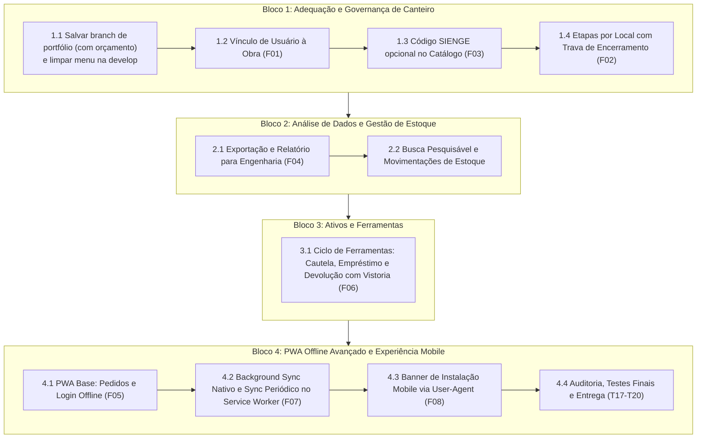

# Planejamento Estratégico e Ordem de Execução: Sistema Obras Jooy

Este documento organiza a evolução do projeto incorporando os feedbacks reais recebidos da construtora e dos professores, detalhando o que foi concluído, o que mudou de escopo e como serão executadas as próximas tarefas.

---

## 1. Visão Geral das Mudanças de Escopo (Feedback do Cliente)

1. **Gestão de Versões no Git (Branch de Portfólio):**
   - Criar uma branch de preservação `portfolio/com-orcamento-obra` para manter todo o trabalho de gráficos e limites orçamentários da **T13**.
   - Na linha principal de entrega (`develop`), retirar a interface de orçamento de obra para adequar à solicitação da construtora.
2. **Vínculo Usuário $\leftrightarrow$ Obra:**
   - Encarregados e Almoxarifes passam a ter sua **obra de lotação fixa** cadastrada no usuário.
   - Elimina o seletor manual de obra nas requisições e no estoque: o usuário já opera direto no seu canteiro.
3. **Etapas de Execução por Local:**
   - Cada Área/Pavimento terá etapas (ex: *Fundação, Alvenaria, Instalações, Acabamentos*).
   - Quando a Engenharia marca a etapa como **Encerrada**, o sistema bloqueia novos pedidos de materiais para ela.
4. **Catálogo de Materiais Desacoplado do SIENGE:**
   - Todo material terá seu código interno próprio (`MAT-001`, `MAT-002`), com um campo opcional e independente `codigoSienge` (caso exista).
5. **Exportação Analítica para a Engenharia:**
   - Módulo de exportação de dados com filtros por período de data, material, código e etapa de aplicação para conferência externa.
6. **Modo Offline com PWA (Progressive Web App):**
   - Capacidade de o encarregado gerar pedidos mesmo no subsolo ou sem sinal 4G, com sincronização automática assim que houver conexão.
7. **Sincronização em Segundo Plano Nativa (Background Sync & Periodic Sync - Feedback do Professor):**
   - Agendamento de tarefas nativas no navegador (`SyncManager` / `PeriodicSyncManager` + `IndexedDB` no Service Worker) para que as requisições pendentes sejam enviadas automaticamente assim que o aparelho recuperar sinal, sem exigir que o usuário abra o aplicativo, além de atualização periódica silenciosa do catálogo a cada 5 minutos em uso.
8. **Banner Inteligente de Instalação Mobile (User-Agent & Display Mode - Feedback do Professor):**
   - Identificação automática quando o usuário acessa o sistema pelo navegador do celular (Android ou iOS) fora do modo instalado (`standalone`), exibindo um banner interativo que orienta o compartilhamento/adição à tela de início para funcionamento completo do PWA.

---

## 2. Mapa Geral das Tarefas (Concluídas vs. Pendentes vs. Novas)

| ID | Descrição Original / Ajustada | Status | Observações / Ajuste de Escopo |
| :--- | :--- | :--- | :--- |
| **SETUP - T08** | Setup, Autenticação, Obras, Materiais e Estoque Físico/Kardex | **Concluído** | PRs #1 ao #9 mergeados na `develop`. |
| **T11 - T12** | Requisições no Canteiro, Baixa Atômica e CSV SIENGE | **Concluído** | PR #10 mergeado na `develop`. |
| **T13** | Orçamento e Limites de Material por Obra | **Concluído** | PR #11 mergeado. Isolado por feature flag (`FEATURE_ORCAMENTO_ATIVO`). |
| **F01** | Vínculo Usuário $\leftrightarrow$ Obra e Eliminação de Seleção | **Concluído** | PR #12 mergeado. Encarregado e Almoxarife operam direto na sua obra. |
| **F02** | Etapas de Execução por Pavimento com Trava ao Encerrar | **Concluído** | PR #14 mergeado. Substitui o controle de teto por controle de fase de obra. |
| **F03** | Código SIENGE Opcional no Catálogo de Materiais | **Concluído** | PR #13 mergeado. Permite cadastrar qualquer item sem esperar código do ERP. |
| **F04** | Relatório Analítico e Exportação para Engenharia | **Concluído** | PR #15 mergeado. Filtros avançados por data, item, código e etapa. |
| **F05** | Modo Offline com PWA (Service Worker + Login Offline) | **Concluído** | PRs #16 e #19 mergeados. Pedidos e autenticação local offline. |
| **F06** | Cautela e Devolução de Ferramentas com Teste Obrigatório | **Concluído** | PR #17 mergeado. Empréstimo e devolução exclusiva pelo almoxarife. |
| **UI / PWA** | Busca Pesquisável no Estoque, Perfil Encarregado e Logo Oficial PWA | **Concluído** | PRs #18, #20, #23, #24 e #25 mergeados. |
| **F07 (Nova)** | Sincronização em Segundo Plano Nativa (Background Sync + Periodic Sync) | **Concluído** | PR #26 mergeado. Envio em background via Service Worker + IndexedDB e sync periódico de catálogo (5 min). |
| **F08 (Nova)** | Banner Inteligente de Instalação Mobile (User-Agent + Standalone) | **Concluído** | Detecta acesso via navegador mobile e orienta adicionar à tela inicial (Android `beforeinstallprompt` e iOS Safari). |
| **T17 - T20** | Auditoria, E2E e Documentação Final | **Concluído / Contínuo** | README, Manual do Usuário e Deploy Render concluídos (PR #21). |

---

## 3. Ordem de Execução Recomendada (Em 4 Blocos Lógicos)

---

### Detalhamento dos Blocos:

### Bloco 1: Governança do Canteiro e Alinhamento com a Jooy (Concluído)
1. **Isolamento de Orçamento:** Módulo de orçamento isolado por feature flag (`FEATURE_ORCAMENTO_ATIVO`).
2. **Vínculo Usuário $\leftrightarrow$ Obra (F01):** Adicionado `obraId` opcional no usuário. Encarregados e almoxarifes têm sua obra fixada automaticamente nas requisições e no estoque.
3. **Código SIENGE Opcional (F03):** O material possui `codigo` (código interno Jooy obrigatório) e `codigoSienge` (opcional/editável a qualquer momento).
4. **Etapas por Local (F02):** Tabela `EtapaArea` vinculada à Área/Pavimento. Etapas com status `ENCERRADA` ficam bloqueadas para novos pedidos.

### Bloco 2: Inteligência para Engenharia e Controle de Entrada (Concluído)
1. **Exportação Analítica da Engenharia (F04):** Exportação CSV com filtros de data inicial/final, código/nome do material e etapa da obra.
2. **Busca Pesquisável no Estoque:** Seletor dinâmico por código ou descrição para inserção e consulta rápida de insumos.

### Bloco 3: Ferramentas e Equipamentos (Concluído)
1. **Cautela de Ferramentas (F06):** Empréstimo vinculado ao colaborador e devolução exclusiva pelo almoxarife com checklist obrigatório de teste de funcionamento na saída e no retorno.

### Bloco 4: PWA Offline Avançado e Polimento Final
1. **PWA Offline Base (F05 - Concluído):** Armazenamento local, login offline com hash SHA-256 + salt e fila de requisições offline.
2. **Sincronização em Segundo Plano Nativa (F07 - Task 1 Atual):**
   - Espelhamento da fila offline e credenciais de sincronização no **IndexedDB** (`obras_jooy_offline_db`) para acesso direto pelo **Service Worker** em segundo plano.
   - Registro automático na **Background Sync API** (`registration.sync.register('obras-sync-requisicoes')`) ao criar pedidos sem sinal, permitindo que o navegador envie os pedidos automaticamente assim que a conexão voltar, mesmo com o aplicativo fechado.
   - Sincronização periódica do catálogo de obras, materiais e ferramentas a cada **5 minutos** enquanto em uso, ao retomar o foco da tela (`visibilitychange`) e via **Periodic Background Sync API** (`obras-periodic-catalog-sync`).
3. **Banner Inteligente de Instalação Mobile via User-Agent (F08 - Task 2):**
   - Detecção de acesso em navegadores móveis (Android e iOS) via `navigator.userAgent` combinado à checagem de modo standalone (`display-mode: standalone`).
   - Exibição de banner instrucional para instalar o aplicativo na tela de início (botão direto via `beforeinstallprompt` no Chrome/Android e passo a passo de compartilhamento no Safari/iOS).
4. **Entrega Final (T17 a T20):** Validação dos fluxos ponta a ponta e atualização da documentação acadêmica e profissional.
