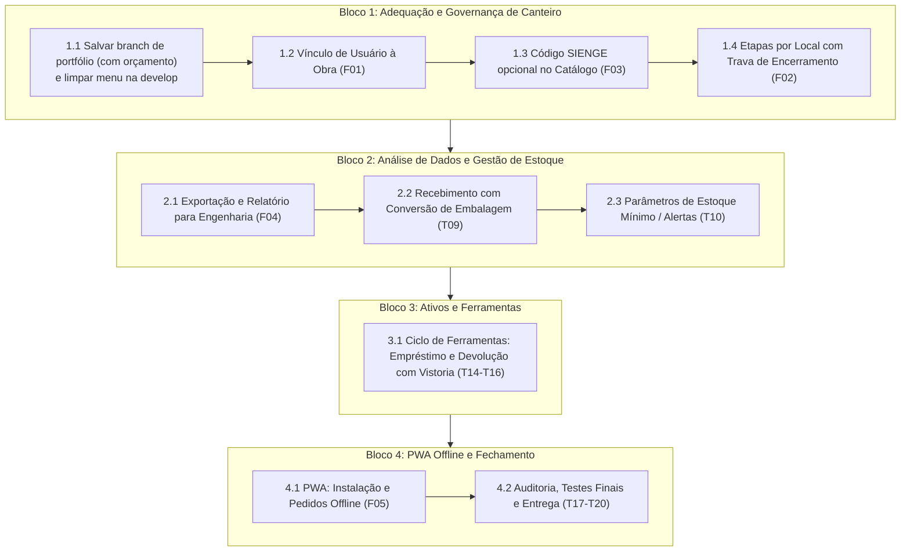

# Planejamento Estratégico e Ordem de Execução: Sistema Obras Jooy

Este documento organiza a evolução do projeto incorporando os feedbacks reais recebidos da construtora e dos professores, detalhando o que foi concluído, o que mudou de escopo e como serão executadas as próximas tarefas.

---

## 1. Visão Geral das Mudanças de Escopo (Feedback do Cliente)

1. **Gestão de Versões no Git (Branch de Portfólio):**
   - Criar uma branch de preservação `portfolio/com-orcamento-obra` para manter todo o trabalho de gráficos e limites orçamentários da **T13**.
   - Na linha principal de entrega (`develop`), retirar a interface de orçamento de obra para adequar à solicitação da construtora.
2. **Vínculo Usuário $\leftrightarrow$ Obra:**
   - Encarregados e Almoxarifes passam a ter sua **obra de lotação fixa** cadastrada no usuário.
   - Elimina o seletor manual de obra nas requisições e no estoque: o usuário já opera direto no seu canteiro.
3. **Etapas de Execução por Local:**
   - Cada Área/Pavimento terá etapas (ex: *Fundação, Alvenaria, Instalações, Acabamentos*).
   - Quando a Engenharia marca a etapa como **Encerrada**, o sistema bloqueia novos pedidos de materiais para ela.
4. **Catálogo de Materiais Desacoplado do SIENGE:**
   - Todo material terá seu código interno próprio (`MAT-001`, `MAT-002`), com um campo opcional e independente `codigoSienge` (caso exista).
5. **Exportação Analítica para a Engenharia:**
   - Módulo de exportação de dados com filtros por período de data, material, código e etapa de aplicação para conferência externa.
6. **Modo Offline com PWA (Progressive Web App):**
   - Capacidade de o encarregado gerar pedidos mesmo no subsolo ou sem sinal 4G, com sincronização automática assim que houver conexão.

---

## 2. Mapa Geral das Tarefas (Concluídas vs. Pendentes vs. Novas)

| ID | Descrição Original / Ajustada | Status | Observações / Ajuste de Escopo |
| :--- | :--- | :--- | :--- |
| **SETUP - T08** | Setup, Autenticação, Obras, Materiais e Estoque Físico/Kardex | **Concluído** | PRs #1 ao #9 mergeados na `develop`. |
| **T11 - T12** | Requisições no Canteiro, Baixa Atômica e CSV SIENGE | **Concluído** | PR #10 mergeado na `develop`. |
| **T13** | Orçamento e Limites de Material por Obra | **Concluído** | PR #11 mergeado. Será preservado em branch específica e ocultado na entrega real. |
| **F01 (Nova)** | Vínculo Usuário $\leftrightarrow$ Obra e Eliminação de Seleção | **Pendente** | Encarregado e Almoxarife operam direto na sua obra. |
| **F02 (Nova)** | Etapas de Execução por Pavimento com Trava ao Encerrar | **Pendente** | Substitui o controle de teto por controle de fase de obra. |
| **F03 (Nova)** | Código SIENGE Opcional no Catálogo de Materiais | **Pendente** | Permite cadastrar qualquer item sem esperar código do ERP. |
| **F04 (Nova)** | Relatório Analítico e Exportação para Engenharia | **Pendente** | Filtros avançados por data, item, código e etapa. |
| **T09** | Recebimento com Conversão e Entrada sem Documento | **Pendente** | Entrada rápida de suprimentos com conversão de embalagem. |
| **T10** | Parâmetros de Estoque Mínimo e Reposição | **Pendente** | Alertas visuais de material acabando no canteiro. |
| **T14 - T16** | Ferramentas: Rastreamento, Empréstimo e Vistoria de Devolução | **Pendente** | Já estruturado na interface do Stitch, pendente fluxo operacional. |
| **F05 (Nova)** | Modo Offline com PWA (Service Worker + Sync) | **Pendente** | Pedidos offline com sincronização em segundo plano. |
| **T17 - T20** | Auditoria, E2E e Documentação Final | **Pendente** | Fechamento para entrega acadêmica e institucional. |

---

## 3. Ordem de Execução Recomendada (Em 4 Blocos Lógicos)

---

### Detalhamento dos Blocos:

### Bloco 1: Governança do Canteiro e Alinhamento com a Jooy (Imediato)
1. **Branch de Portfólio:** Criar a branch `portfolio/com-orcamento-obra` com o estado atual. Na `develop`, ocultar o link de orçamento da navbar.
2. **Vínculo Usuário $\leftrightarrow$ Obra (F01):** Adicionar `obraId` opcional no usuário. Encarregados e almoxarifes passam a ter sua obra fixada automaticamente nas requisições e no estoque.
3. **Código SIENGE Opcional (F03):** O material passa a ter `codigo` (código interno Jooy obrigatório) e `codigoSienge` (opcional/editável a qualquer momento).
4. **Etapas por Local (F02):** Criar tabela `EtapaArea` vinculada à Área/Pavimento. Na requisição, o encarregado escolhe a etapa. Etapas com status `ENCERRADA` ficam bloqueadas para novos pedidos.

### Bloco 2: Inteligência para Engenharia e Controle de Entrada
1. **Exportação Analítica da Engenharia (F04):** Modal na tela de requisições ou página própria para baixar CSV com filtros de data inicial/final, código/nome do material e etapa da obra.
2. **Recebimento e Conversão (T09):** Entrada simplificada de mercadoria com conferência física e conversão de caixas/fardos em unidades de consumo.
3. **Estoque Mínimo (T10):** Definição de ponto de pedido para insumos críticos (cimento, areia, luvas) com alerta visual quando o saldo baixar do limite.

### Bloco 3: Ferramentas e Equipamentos (T14 a T16)
1. Conectar a interface moderna já existente com o fluxo de empréstimo (associado ao encarregado/operário) e devolução com apontamento de ferramentas danificadas.

### Bloco 4: PWA Offline e Polimento Final
1. **PWA Offline (F05):** Configuração do Vite PWA (`vite-plugin-pwa`), armazenamento local no IndexedDB e sincronização automática em segundo plano quando a conexão voltar.
2. **Entrega Final (T17 a T20):** Validação dos fluxos ponta a ponta e preparação da documentação acadêmica e profissional.
